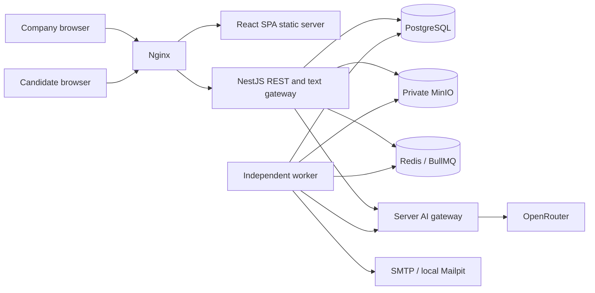
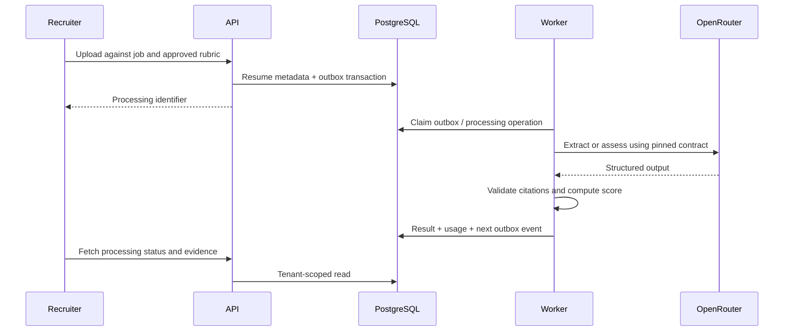

# SmartRecruit AI architecture

Phase 0 design, 2026-10-27. Product authority: [MASTER_SPEC.md](MASTER_SPEC.md). Engineering authority: [AGENTS.md](../AGENTS.md). This document describes proposed implementation, not deployed functionality.

## System boundaries

Use a pnpm workspace with a modular NestJS API, a separately running BullMQ worker, and a React + Vite SPA. The API owns authorization, transactions, deterministic business rules and interview orchestration. Workers execute asynchronous operations using the same domain services and contracts. PostgreSQL owns durable business state; Redis is disposable coordination and queue transport, never the interview transcript or sole record of pending work. MinIO holds private files. OpenRouter is accessed only by the server-side AI gateway. SMTP delivers notifications; Mailpit captures development email.

The API and worker are independent processes, not independent domain microservices. Initially the worker imports explicitly exported backend domain services through workspace package exports; it must not import the API HTTP bootstrap or start gateways. `packages/shared` holds transport DTO types without database access; `packages/config` holds validated configuration; `packages/ai-contracts` holds versioned prompts, JSON schemas, fixtures and task names. Server validation remains authoritative even when schemas/types are shared with the browser. If import boundaries become difficult, extract server libraries in a later approved change rather than duplicate domain logic.

## Mandatory stack and repository layout

Adopt the complete target repository tree in [MASTER_SPEC.md §5](MASTER_SPEC.md#5-target-repository-structure), including all named API modules. This is the end-state layout, not permission to scaffold in Phase 0:

| Target paths | Phase allocation |
|---|---|
| `apps/web/src/{app,components,features,hooks,lib,routes,services,types}/`, `apps/web/Dockerfile`, `apps/web/package.json` | Phase 1 foundation, feature contents in their owning phases |
| `apps/api/src/{auth,companies,memberships,jobs,candidates,resumes,resume-assessments,candidate-rankings,interview-invitations,interview-sessions,interview-engine,interview-assessments,ai-gateway,notifications,storage,usage,audit,common}/` | Phase 1 API foundation; modules implemented only in their owning phases |
| `apps/api/prisma/`, `apps/api/Dockerfile`, `apps/api/package.json` | Phase 1 migration/build foundation; domain migrations in their owning phases |
| `apps/worker/src/{processors,queues}/`, `apps/worker/Dockerfile`, `apps/worker/package.json` | Phase 1 bootstrap; first notification processor/dispatcher in Phase 2 |
| `packages/{shared,config,ai-contracts}/` | Phase 1 workspace boundaries; AI contracts in Phase 3 onward |
| `infrastructure/{nginx,postgres,minio}/`, `tests/e2e/` | Phase 1 infrastructure/test setup, tests extended each phase |
| `AGENTS.md`, `README.md`, `docs/{MASTER_SPEC,PHASE_0,architecture,database,ai-workloads,interview-lifecycle,infrastructure,implementation-plan,progress}.md` | Preserve instructions/specifications; Phase 0 design documents; ongoing progress/README updates |
| `docker-compose.yml`, `docker-compose.dev.yml`, `.env.example`, `pnpm-workspace.yaml`, `package.json` | Phase 1; secrets excluded, dependencies pinned in generated lockfile then |

Frontend is React.js + TypeScript + Vite with the libraries described below; no Next.js. Backend is NestJS + TypeScript + REST + Socket.IO with class-validator/class-transformer and Swagger/OpenAPI. PostgreSQL/Prisma migrations, Redis/BullMQ, S3-compatible MinIO, server-side OpenRouter, SMTP/Mailpit and Docker Compose/Nginx remain mandatory. Jest or Vitest and Playwright use explicitly configured deterministic mock AI in CI. Text-only scope and all exclusions in master §3 remain binding: no public applications/job board, payments/subscription billing, or media functionality.

## Principal flows

1. Company requests pass JWT verification, active membership lookup, role checks, tenant-scoped resource lookup, validation and transaction. A route's company ID selects a membership to verify; it never grants access itself.
2. Job analysis produces an editable draft. Approval validates weights and creates an immutable rubric version. Every downstream assessment references that version.
3. Upload accepts bounded PDF/DOCX bytes, validates type/signature, writes a private quarantine object, then commits resume metadata and a processing outbox event. Workers perform safety checks, text extraction, structured extraction, candidate association, assessment and backend scoring. Queue and UI states reflect failures.
4. Recruiter shortlists a job candidacy, approves the job's interview plan, then issues invitations. Invitation validation creates a restricted candidate grant. Consent and explicit start precede any interview turn.
5. Candidate commands go through the transport-independent orchestrator. It commits messages and events before acknowledgements. Durable tasks generate the next question; completion freezes the transcript and schedules evaluation through the outbox.
6. Evaluation validates evidence and persists an immutable assessment. The company sees separate resume/interview results and a human decision history; AI never performs a hiring decision.

## Backend modules and public boundaries

| Module | Responsibility and representative routes |
|---|---|
| `auth` | Register company/admin atomically, login/logout, refresh rotation, reset password, CSRF; `/auth/*` |
| `companies`, `memberships` | Workspace profile, settings, team invitations/acceptance, role changes; `/companies/:companyId/*` |
| `jobs` | Job CRUD/status, analysis operations, rubric and interview-plan drafts/approval; `/jobs/:id/evaluation-configs`, `/jobs/:id/interview-plans` |
| `candidates` | Company identity, search, job candidacies, recruiter decision history, deletion requests |
| `resumes` | Validated uploads, immutable versions, processing status, authorized downloads |
| `resume-assessments` | Versioned evaluation operations, citations, deterministic score persistence |
| `candidate-rankings` | SQL ranking by job, exact rubric/model cohort and current successful resume assessment |
| `interview-invitations` | Bulk/individual issuance, revoke/resend, token exchange, attempt restrictions |
| `interview-sessions` | Session ownership, consent, authoritative REST snapshot/event replay and cancellation |
| `interview-engine` | Pure transition and policy rules, `InterviewOrchestrator`, isolated `TextInterviewGateway`, turn tasks |
| `interview-assessments` | Frozen-transcript evaluation, reports, explicit reevaluation |
| `ai-gateway` | Per-task routing, prompt/schema versions, privacy policy, provider calls and validation |
| `notifications`, `storage` | SMTP delivery operations; private S3-compatible object abstraction |
| `usage`, `audit` | Tenant metrics and append-only attribution; no raw sensitive content |
| `common` | Tenant context, authorization primitives, transaction/outbox helpers, error codes, request IDs, health |

REST paths are company-scoped under `/api/v1/companies/:companyId` except auth and candidate routes. Use pagination and bounded sorting/filtering. Errors expose stable codes, safe messages and correlation IDs. Asynchronous actions return `202` with operation ID. Approval, uploads, invitation issuance and decision commands accept idempotency keys. Mutations use revision checks where stale writes could overwrite another user's work. The NestJS TypeScript API uses class-validator and class-transformer for DTO validation/transformation, and Swagger/OpenAPI for DTOs and authorization. DTO validation rejects unknown fields; transformations must not silently coerce invalid business values. Never bind request bodies directly to Prisma writes.

Phase 2 owns the first working SMTP notification adapter, encrypted token payload handling, tenant/global delivery ledgers, transactional outboxes, DB-polled dispatcher and retry/status UI. Phase 3 extends this foundation for AI operations; Phase 6 adds candidate invitation templates and lifecycle rules. Team invitations and password resets must work through Mailpit before Phase 2 acceptance; they cannot depend on Phase 3 or Phase 6 implementation.

Interview recovery distinguishes `revision` (all state changes) from `conversationRevision` (semantic transcript/progression changes). Presence transitions and grant rotation do not invalidate an accepted pending turn. Persistent turn identity, leased request attempts, staged validated response and atomic publication are specified in [interview lifecycle](interview-lifecycle.md#durable-pending-turn-recovery); the worker checks current session authorization, not an expired initiating browser grant.

## Authorization and privacy

| Actor | Allowed actions |
|---|---|
| Company admin | All company recruitment work, team roles/invitations, settings, retention/deletion requests |
| Recruiter | Jobs/rubrics/plans, uploads, shortlist/invitations, reports and human decisions; no membership or retention administration |
| Viewer | Read-only recruitment data, evidence and authorized files; no mutation or team administration |
| Candidate grant | Only its invitation/session, consent, own chat and completion; no other candidates, ranking, internal report or company endpoints |
| Platform operator | No implicit tenant API access; production support access requires a separately designed, time-limited audited procedure |

Users can belong to many companies. Check membership on every request rather than trust a stale JWT role. Prevent removal/demotion of the last active admin using a locked company transaction. Staff access JWTs are short-lived (proposed 10 minutes) in browser memory; rotating opaque refresh tokens use Secure, HttpOnly, same-site cookies and server-side hashes. Rotation uses a session family and transaction: reuse revokes the family; browser refresh is single-flight. Password reset is single-use, hash-stored, expires after 30 minutes, and revokes existing sessions. Passwords use Argon2id with parameters calibrated in implementation. Login/reset responses avoid account enumeration and apply account/IP rate limits.

Cookie-authenticated mutation and token refresh/exchange endpoints require origin checks and CSRF tokens. Production requires HTTPS; local HTTP cookie exceptions are development-only. Candidate cookies have a separate audience and narrow path. Candidate and team tokens use at least 256 bits of random entropy, hashed at rest; secrets never appear in logs. Invitation links place the token in the URL fragment, remove it from browser history immediately, and exchange it in a request body. Apply `Referrer-Policy: no-referrer`, no third-party analytics on candidate pages, and redaction of request bodies/headers.

Tenant isolation is enforced in repositories and domain services for REST, workers, gateway, storage and reports. Every tenant child row has `companyId` and composite foreign keys. PostgreSQL RLS is deferred to avoid introducing untested connection-pool context assumptions; this increases the importance of mandatory scoped repositories and negative integration tests. Raw SQL is reviewed and explicitly tenant-bound. Queue payloads carry only IDs and tenant context; workers reload and verify relationships. Object keys include tenant and random IDs, but keys never authorize access. Downloads are streamed by an authorized API endpoint (avoid bearer download links in MVP). Socket room names and session IDs do not authorize membership. Session commands revalidate grant/revocation and ownership, including after reconnect.

Retention settings, deletion, consent versioning and provider privacy restrictions are release gates. Resume/transcript content is encrypted at rest through deployment storage controls and sent to providers only as minimized input. Structured logs contain identifiers, state, latency and safe error codes, not passwords, tokens, resume text or full transcripts. Audit records describe actions without duplicating candidate content. No production legal-compliance claim is implied.

## Frontend architecture

`apps/web/src/app` owns providers and route bootstrapping; `routes` owns public, staff and candidate layouts. `features` groups auth, workspace, jobs/rubrics, candidates/resumes, interviews, team, usage and settings. `components` contains accessible shadcn/ui primitives and shared presentation; `services` contains the typed API client and Socket.IO client; `lib`, `hooks`, `types` contain focused helpers. React Router manages navigation, TanStack Query owns remote state, React Hook Form + Zod manage forms, Tailwind styles views. No Zustand initially: local React state/context suffice for draft input and authentication coordination.

Public routes: landing, registration, login, reset request/confirmation, team invitation acceptance. Staff routes: overview, jobs CRUD, rubric draft/edit/approval, bulk upload/status, candidates/search/ranking, candidate evidence, shortlist, plan approval, invitation management, transcript/report, decisions, team/settings and usage. Candidate layout: invite validation, privacy/consent, instructions, chat/progress, completion, expired/revoked and reconnect views. Route guards improve UX only; backend enforcement is mandatory.

Query keys begin with company ID; workspace changes cancel requests and clear sensitive old caches. Do not persist auth, resumes, transcripts or report caches to localStorage. Use authoritative query invalidation after approvals/decisions; never optimistically mark an upload assessed, invite delivered or message accepted. Bulk progress uses polling initially. Chat displays durable acknowledgement status; local unsent input can survive reconnect in memory, with clear retry controls. Render content as escaped text, no arbitrary AI HTML. Include keyboard navigation, focus management, screen-reader status announcements, accessible error summaries and responsive layouts.

## Important decisions and ambiguities

| Topic | Proposed default and tradeoff |
|---|---|
| Scoring missing evidence | Separate evidence coverage from score; resume missing evidence contributes zero demonstrated points, not a claim of inability. Interview unasked criteria are excluded. Details in database design; approval requested. |
| Candidate deduplication | Recruiter selects existing candidate or creates new; AI suggests possible matches but never merges on name/email alone. Costs extra review but avoids identity contamination. |
| Plan standardization | Approve core questions per job/rubric. Resume context may suggest bounded follow-ups, never silently change core questions for a candidate. |
| Plan timing | Invitation functionality in Phase 6 requires an approved plan reference; minimal manual approval is introduced there, AI plan drafting/orchestration in 7B. This resolves the roadmap's invitation-before-plan dependency. |
| Human decisions timing | Minimal human shortlist in Phase 5 supports Phase 6; complete decision history UI and dashboard in Phase 9. |
| Invitations and attempts | Seven-day invitation expiry is the acceptance/start cutoff: exchanged but unstarted sessions cannot start after it. Started sessions use their immutable interview deadline. One reserved/active attempt per job candidacy is DB-enforced across invitations; resend only rotates the current token, with no expiry extension or new attempt. Only explicit recruiter re-invite after closure creates another attempt. See lifecycle expiry/attempt tables. |
| Interview bounds | Proposed approved defaults: 6 core questions, at most 2 follow-ups per core, 30-minute wall-clock budget starting at first start; recruiter-configurable within hard safety ceilings. |
| Retention | Proposed 180 days after candidacy closure, delete candidate when all candidacies qualify; consent withdrawal cancels active interview and initiates deletion review. Confirm policy before production. |
| Infrastructure | One API replica initially; no Redis socket adapter required. Horizontal scaling later requires event delivery/room coordination while DB locking stays authoritative. |
| Provider configuration | Spec's model IDs are candidates only; real-mode catalog, structured output and privacy compatibility must be verified in Phase 3. No silent mock fallback. |

No direct stack contradiction was found. Product policy details above are assumptions, not requirements added to the master spec. Retention jurisdiction, candidate notice wording, provider data handling and automated-assessment policy need owner review before production. Source requirements for stored consent are interpreted as consent for the interview; the company must separately establish a basis and notice for externally collected resumes before provider processing.

## Failure and operational risks

| Dependency/failure | Behavior and recovery |
|---|---|
| PostgreSQL unavailable | Reject mutations and pause workers; no durable acknowledgement. Reconnect with bounded backoff; restore from tested backups for loss. |
| Redis unavailable/lost | Commit DB operations/outbox where safe, show pending work; pause queue processing and replay missing operations after recovery. Chat REST recovery still works; no state lost from Redis alone. |
| MinIO unavailable | Upload/download return retryable failures. Object-first upload failures are reconciled by private staging cleanup; missing objects block parsing explicitly. |
| OpenRouter timeout/rate limit/invalid output | Bounded retry, attempt usage recorded, operation visibly failed after exhaustion. Interview freezes turn progression while retryable; never invent answer or silently switch provider. |
| SMTP unavailable | Retry durable notification operation; show delivery state. Copy-link action can issue a fresh token; never report delivered on enqueue. |
| API/worker crash | Durable operations, leases and version checks recover; duplicate computation may occur, duplicate domain effects must not. |
| Unsafe/malformed resume | Quarantine, bounded parser resources, no macros/network execution, explicit failure; production malware scanner decision is a deployment gate. |
| Expired/deleted data races | Workers check deletion state before calls and before commits; stale results are discarded and objects purged. |

Use structured correlation IDs across API/outbox/queue/provider, health/readiness, queue age/failure counts, parsing latency, turn latency and AI usage/cost metrics. Metrics must avoid candidate text and unbounded per-candidate labels. Security test coverage and remaining release risks are detailed in the [implementation plan](implementation-plan.md).
