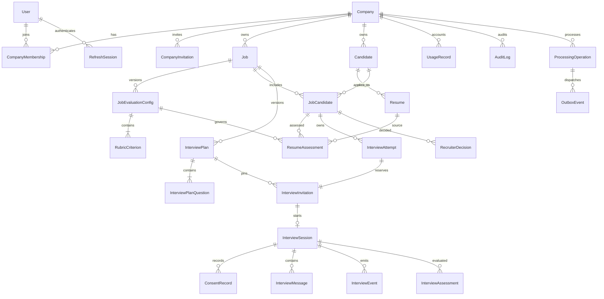

# PostgreSQL domain and integrity design

Phase 0 design only; no schema or migrations are implemented. Use Prisma migrations and explicit SQL migrations for checks, partial indexes and other constraints not represented by the selected Prisma version. PostgreSQL stores all authoritative domain and processing state.

## Keys, tenancy and conventions

Use UUID primary keys, UTC `timestamptz` timestamps, explicit status enums/checks and integer revision counters for mutable aggregates. Every tenant-owned table contains non-null `companyId`, references `Company`, and has `UNIQUE(companyId, id)` for composite references. All relationships between tenant rows use `(companyId, parentId)` foreign keys; never connect records by a globally unique ID alone. Additional composite keys below enforce job/candidate/version alignment. Global auth tables are `User`, `RefreshSession`, `PasswordResetToken`; `Company` is the tenant root. All other tables, including usage/outbox/consent, are tenant-owned. Auth-only audit events without a tenant use separate `AuthSecurityEvent` records, not nullable tenant ownership in `AuditLog`.

Money uses fixed precision decimal with currency; criterion ratings use integers 0–4; rubric weights use basis points totaling 10,000. Store score with fixed precision and round only display values. Application approval locks the draft and validates cross-row weight totals in one transaction. A database trigger enforces immutable approved configs/criteria/plans and completed assessments; deletion is a narrowly authorized purge operation, not ordinary update access.

ERD shows main relationships; supporting tables and exact constraints follow. Actor IDs in tenant records should reference a company membership where appropriate; membership rows are deactivated rather than removed while attribution is retained. User deletion anonymizes attributable display details according to retention policy.

## Tables and relationships

| Table | Principal fields and invariants |
|---|---|
| `User` | Unique normalized email, password hash, verified/status timestamps; no company field. Never expose hash. |
| `RefreshSession` | User FK, unique token hash, family ID, expires/revoked/rotated timestamps, successor ID; atomic rotation and replay-family revocation. |
| `PasswordResetToken` | User FK, token hash, expiry, consumed timestamp; atomic one-time consumption. |
| `AuthSecurityEvent` | Optional user ID, event kind/time, safe network metadata with retention; no credential values. |
| `Company` | Name, status, settings revision, retention policy and version, timestamps. Lock to protect last-admin rule. |
| `CompanyMembership` | User FK, company role/status; unique `(companyId,userId)`. |
| `CompanyInvitation` | Normalized email, role, issuer membership, unique token hash, expiry, consumed/revoked timestamps; one active invite per company/email via partial index; only admin issues roles. |
| `Job` | Title, description, department, employment type, work arrangement, location, requirements draft, status exactly `DRAFT`, `ACTIVE`, `PAUSED`, `CLOSED`, `ARCHIVED`, creator membership, revision, created/updated timestamps; archive preserves history. These are the master §8 enum values; no substitute statuses. |
| `JobEvaluationConfig` | Job FK, version, `DRAFT/APPROVED/SUPERSEDED`, scale/scoring-policy versions, source JD snapshot/hash, AI artifact reference, approver/time; unique `(companyId,jobId,version)` and `(companyId,jobId,id)`. Approved payload frozen even when superseded. |
| `RubricCriterion` | Config FK, stable criterion key within version, label, description, weight basis points, anchored rating scale, evidence requirements, order; unique `(companyId,configId,key)`, nonnegative weights; approval total 10,000. |
| `Candidate` | Company-scoped identity, display name, contact data, normalized searchable fields, status `ACTIVE/DELETION_PENDING/DELETED`; email/name are not unique identity keys. No cross-company identity linking. |
| `JobCandidate` | Job FK, candidate FK, selected resume ID, current compatible assessment IDs, created timestamps; unique `(companyId,jobId,candidateId)` and composite keys including candidate/job. Resume selection must refer to same candidate. |
| `Resume` | Candidate FK nullable only while unassociated ingestion is pending, ingestion job FK, uploader, version after association, object key, content SHA-256, original safe name, MIME/size, processing status, extracted-text artifact, parser version; immutable file and extracted snapshot after success. Unique `(companyId,candidateId,version)` for associated versions. |
| `ResumeAssessment` | JobCandidate, candidate, job, resume and config FKs, version, operation/artifact ID, rating/evidence summary, deterministic points/coverage, scoring-policy version, created time; unique operation result. Contains only successful immutable results; failures live in operations. |
| `ResumeCriterionResult` | Assessment FK, criterion FK within pinned config, evidence status, nullable rating, confidence/uncertainty, rationale. Unique assessment/criterion; evidence child rows reference resume text spans and exact quotes. |
| `InterviewPlan` | Job/config FK, version, status, approval membership/time, core count, follow-up cap, wall-clock budget, policy version; unique `(companyId,jobId,version)` and `(companyId,jobId,configId,id)`. Frozen approved body and ordered questions. |
| `InterviewPlanQuestion` | Plan FK, question key/order, exact approved core text, criterion references, allowed follow-up scope; unique plan/key and plan/order. Criterion join rows enforce config membership. |
| `InterviewAttempt` | JobCandidate FK, positive attempt ordinal, status `RESERVED/ACTIVE/EXPIRED/CANCELLED/COMPLETED`, created/started/closed timestamps, closure reason, issuer/re-invite audit reference; partial unique live reservation and ordinal constraints below. |
| `InterviewInvitation` | Unique attempt FK, JobCandidate/job/config/plan FKs, selected resume version, current token hash/generation/purpose `START/RECOVERY`, issuedAt, immutable expiresAt (acceptance/start cutoff), tokenExpiresAt, acceptedAt/revokedAt, issuer, notification status; one invitation per attempt and one session per invitation. Resend retains expiresAt; recovery token expiry never exceeds existing session deadline. All pins must belong to the same job/candidate. |
| `CandidateAccessGrant` | Invitation/session FK, token hash, expires/revoked timestamps, generation; restricted candidate credential, no staff membership. Rotation/resend invalidates old grants. |
| `InterviewSession` | Unique invitation and attempt FKs, copied immutable config/plan/resume pins, state, general revision, conversationRevision, pendingTurnOperationId, turnGeneration, interruption reasons, next message/event sequences, current question key, core/follow-up counters, started/deadline/completed timestamps, completion reason, transcript hash. Presence/grant changes do not advance conversationRevision. |
| `ConsentRecord` | Session/candidate FK, notice version/hash and purpose, accepted/withdrawn timestamps and minimal proof metadata; immutable event records. Withdrawal creates new record, never rewrites acceptance. |
| `InterviewMessage` | Session FK, per-session sequence, sender, client idempotency key, content hash, text, question reference, answerToQuestionId for candidate answers, responseToCandidateMessageId for assistant responses, originating operation ID, accepted timestamp; unique `(companyId,sessionId,sequence)`, candidate command key, answer per question and assistant response per accepted answer. Immutable after commit except privacy purge. |
| `InterviewEvent` | Session FK, ordered event sequence, event type, safe payload schema version, command ID and state revision; unique session/event sequence. Durable events include message IDs, not duplicated transcript text. |
| `InterviewAssessment` | Session/config/plan FKs, version, transcript hash/last sequence, evaluation and report artifact IDs, observed score, coverage, strengths/gaps, immutable report; unique operation result. |
| `InterviewCriterionResult` | Assessment/criterion FKs, `ASSESSED/INSUFFICIENT_EVIDENCE/NOT_ASKED`, nullable rating, rationale; evidence links reference candidate message IDs and question IDs in this session, with quote spans. |
| `RecruiterDecision` | JobCandidate FK, decision enum from spec, actor membership, rationale, monotonically increasing decision version, time; append-only. Latest version is current human decision, independent of AI results. |
| `UsageRecord` | Operation/task/attempt, AI mode, model/provider, prompt/schema version, input/output/cache tokens where returned, estimated/actual cost, currency/rate source/time, latency/outcome; unique attempt ID, nullable costs when unknown. |
| `AuditLog` | Actor type and ID, action, entity type/ID, request ID, timestamp, non-sensitive structured change summary; append-only and tenant-scoped. |

An uploaded resume may remain unassociated until extraction and recruiter confirmation. Pipeline state `AWAITING_ASSOCIATION` is explicit. If uploaded against an existing candidacy, candidate is already known. A recruiter may explicitly choose “create new candidate” at upload; otherwise the UI offers suggested matches and confirmation. Candidate creation and job-candidacy association are transactional and idempotent. Never reuse extracted personal data across tenants.

## Supporting durable workflow tables

| Table | Why it exists |
|---|---|
| `ProcessingOperation` | Domain operation key, kind, subject IDs, pinned input versions/hash, `PENDING/RUNNING/RETRY_WAIT/RESULT_READY/SUCCEEDED/FAILED/CANCELLED`, attempt count/retry cycle/deadline, lease expiry/fencing generation, safe failure code. Turn operations additionally pin session, candidate message, conversationRevision, turnGeneration and staged artifact ID. Unique company/kind/idempotency key; stable next-turn operation key per accepted answer. |
| `OutboxEvent` | Same-transaction dispatch record, operation FK, topic, schema version, ID-only payload, available time, published time; reconciler can redispatch operations even if Redis loses published jobs. |
| `AIArtifact` | Validated output and contract version, task/model/provider pins, input hash, originating operation and usage reference; private data subject to candidate retention, not application logs. Invalid raw provider output is not persisted by default. |
| `NotificationDelivery` | Tenant recipient/reference, template/version, unique operation key, token generation, delivery states `PENDING/SENDING/RETRY_WAIT/SMTP_ACCEPTED/FAILED/CANCELLED/EXPIRED`, attempt/lease metadata and SMTP acceptance time. Token-bearing payload encrypted with separate env-managed key, short TTL and purge after acceptance, revocation, terminal failure or expiry; hashes alone cannot recreate invitation emails. Introduced in Phase 2; tenant operation mirrors delivery: SENDING→RUNNING, SMTP_ACCEPTED→SUCCEEDED, RETRY_WAIT/FAILED/CANCELLED correspond directly, EXPIRED→CANCELLED with expiry reason. Update both in one transaction. |
| `DeletionRequest` | Candidate, policy/reason, status, deletion cutoff, object manifest, purge progress/error and completion; no resume/transcript content in tombstone. |

Password resets are global user operations and must not be assigned an arbitrary company. Use separate global `AuthNotificationDelivery` and `AuthOutboxEvent` tables with user/reset-token references for durable reset email, the same encryption/expiry/retry discipline, and an auth-only dispatcher path, all introduced in Phase 2. AuthNotificationDelivery owns its operation key, status, attempts and lease directly (no tenant ProcessingOperation FK); AuthOutboxEvent references that delivery ID. Tenant team invitations use NotificationDelivery, ProcessingOperation and OutboxEvent, also introduced in Phase 2. Reset-token hash, encrypted delivery payload and auth outbox commit together; company-invitation hash, tenant delivery/operation and tenant outbox commit together. They are never exposed through company notification APIs. Company invitation and recruitment notifications remain strictly tenant-owned. These are additional global auth tables alongside the auth tables above. Phase 2 migrations contain only auth/team notification fields and dependencies. AIArtifact references and AI-specific operation metadata are additive Phase 3 migrations; session/message/turn references arrive in 7A/7B. Phase 2 startup and dispatch cannot import or query those later domains.

Resume text artifacts retain stable page/paragraph/span IDs. Assessment evidence must point into the exact stored extraction snapshot. JSONB may hold versioned validated report/AI structures; ownership, referential keys, ratings, sortable scores, versions and lifecycle state remain relational. Citation rows use foreign keys where possible and application validation for offsets/exact substrings. External JSON never directly becomes trusted DB relations.

## Additional integrity rules and indexes

- Resume assessments reference `(companyId,jobCandidateId,jobId,candidateId)`, `(companyId,resumeId,candidateId)` and `(companyId,configId,jobId)` composite keys. Unassociated resumes cannot be assessed.
- Plans reference the same job/config; invitations reference the same candidacy/job and plan/config. Session pins must equal invitation pins. Criterion results must belong to the assessment's config and evidence to its resume/session. Implement with composite foreign keys and approval/commit validation, not tenant filtering alone.
- `JobCandidate.selectedResumeId` is changed explicitly; a new upload or rubric approval does not overwrite historical assessments. Current assessment pointers update only when successful and still match the selected resume/config/cohort; concurrent old completion cannot replace a newer selection.
- Assessment versions are allocated under aggregate locks. Repeated operation IDs return the same result; explicit reevaluation creates a new operation and version. Model/prompt/schema/input snapshot pins are immutable per operation.
- Index tenant-leading query patterns: jobs `(companyId,status,createdAt,id)`; candidates `(companyId,normalizedEmail)` and name search; candidacies `(companyId,jobId,createdAt,id)`; assessments `(companyId,jobId,configId,createdAt)`; invitations `(companyId,jobCandidateId,expiresAt)`; sessions `(companyId,state,deadlineAt)`; usage/audit `(companyId,createdAt,id)`.
- Index every foreign-key referencing tuple and global token hashes uniquely. Outbox partial index on due unpublished events; operations partial index on due pending/retry or expired leases; text messages/events indexed by session/sequence. Ranking uses compatible successful assessment points and stable `JobCandidate.id` tie-break, with pagination.
- Default deletion is restrictive for referenced versions. Explicit privacy purge removes dependent evidence/artifacts/messages and objects in a controlled workflow; never rely on a broad cascade from a routine candidate update. Candidate deletion does not delete another candidate's shared job rubric/plan.

## Attempt and turn integrity

`InterviewAttempt` is a tenant-owned support entity, not a new recruiting feature. It makes the existing one-active-attempt policy enforceable before session creation. Add `UNIQUE(companyId,jobCandidateId,ordinal)` and a partial unique index on `(companyId,jobCandidateId) WHERE closedAt IS NULL`. Check that `RESERVED/ACTIVE` implies null closedAt and `EXPIRED/CANCELLED/COMPLETED` implies non-null closedAt. Do not use a time-dependent `now()` index predicate. `InterviewInvitation` has unique `(companyId,attemptId)` and a composite FK `(companyId,attemptId,jobCandidateId)` to the attempt's corresponding unique tuple. Session has unique `(companyId,attemptId)` and `(companyId,invitationId)`, with composite FK `(companyId,invitationId,attemptId)` to the invitation tuple; thus a session cannot borrow another reservation. Attempt ordinal belongs only to the attempt, not independent mutable counters on invitations.

Issuance locks JobCandidate and allocates the next ordinal transactionally; different issuance keys still serialize on that row. It creates reservation, invitation and notification/outbox atomically. Re-invitation is explicit and allowed only after closure, with a new ordinal; resends rotate the same invitation and never extend expiresAt. Acceptance is not start; CREATED/READY retain RESERVED. Start moves attempt to ACTIVE and session to IN_PROGRESS atomically only before expiresAt. Expiry before start closes EXPIRED and cancels the session if one exists; session completion/cancellation closes COMPLETED/CANCELLED atomically. Evaluation does not retain a live reservation. Every command also handles due expiry lazily; sweeper downtime cannot bypass the start predicate or unique reservation. Revocation invalidates all token generations and grants. Old tokens remain unusable even after their reservation is released.

Lifecycle owns the complete [expiry/attempt transaction policy](interview-lifecycle.md#expiry-access-and-cancellation-policy). Transactions touching parents use `JobCandidate → InterviewAttempt → InterviewInvitation → InterviewSession → ProcessingOperation` lock order. Session-only operations never acquire a parent later. Database constraint tests must prove duplicate live reservations and cross-candidacy session references fail even when different request keys/tokens are used. Expired/completed history remains; no candidate-facing operation automatically grants another attempt.

For turns, add unique `(companyId,sessionId,clientMessageId)` for candidate message keys; unique `(companyId,sessionId,answerToQuestionId)` for candidate answers; unique `(companyId,sessionId,responseToCandidateMessageId)` for assistant messages when that field is non-null. Same-session composite FKs tie those references to actual messages, with sender/type checks in domain validation. An initial core question has no response-to-answer key. A turn operation's candidate message/session FK and the session's pending operation reference must agree on company/session, enforced by composite keys and commit checks. Only one unfinished next-turn operation per accepted answer is allowed; retries use its stable ID with new fenced generations. AI request attempts have unique `(operationId,retryCycle,attemptNumber)` and durable request/input/deadline/lease metadata; their usage attempt IDs are unique. A staged AIArtifact belongs to that operation/attempt and matching pins, never a generic unscoped response blob.

`RESULT_READY` means validated response persisted but not published. Assistant message/event, counters, semantic revision, operation success and pending-pointer clearance commit together. Worker leases can change without changing semantic turn identity; general state revision/presence/grant rotation do not fence AI output. Terminal cancellation increments semantic revision and clears/cancels pending work. Exhausted or invariant-conflicting operations become visible FAILED, not abandoned RUNNING. See [durable recovery](interview-lifecycle.md#durable-pending-turn-recovery) for recovery of every state and exactly-one next-question publication.

Job status meanings follow the master enum: DRAFT is preparation, ACTIVE is recruiting, PAUSED temporarily suspends new recruitment activity, CLOSED ends recruitment, ARCHIVED retains historical records outside active lists. The master specifies values rather than a full transition graph; Phase 3 must document/test any further transition guards as explicit assumptions. Status edits never mutate approved rubric history or silently cancel already-started interviews; cancellation uses the explicit interview command.

## Deterministic scoring and comparability

Proposed `scoring-policy-v1`: each criterion has anchored integer rating 0–4 and weight `w` in basis points. Resume score is `100 * sum(w * rating/4) / 10000`; `INSUFFICIENT_EVIDENCE` has null rating and contributes zero demonstrated points. Coverage is the weight percentage with validated sufficient evidence. `REQUIREMENT_NOT_MET` requires cited contradictory evidence, not mere omission; its rating follows the approved anchors. Display missing evidence prominently: a low demonstrated score does not assert the candidate lacks a skill. No automatic rejection, threshold-driven hiring decision or merged resume/interview score.

Interview observed score is `100 * sum(assessed w * rating/4) / sum(assessed w)`, with null score if no criteria are assessable. `NOT_ASKED` and insufficient evidence are excluded from the denominator and shown in coverage/gaps. Thus unasked questions are not penalized. Interview scores with different coverage are not ranked automatically. Resume ranking is job-scoped and only within an exact rubric, scoring policy, extraction/evaluation prompt and configured model cohort; show other versions separately with explicit reassessment controls. Provider-returned model identity is also recorded; detected incompatible model changes require a new cohort. Equal scores share displayed rank with stable ordering; missing/failed assessments remain unranked.

## Retention, deletion and backups

Proposed retention is 180 days after each job candidacy closes; a candidate and shared resume versions are purge-eligible only after all their candidacies qualify, unless an authorized deletion request requires earlier removal. Job closure/archival records candidacy closure dates explicitly. Active candidates are reviewed periodically rather than silently retained forever. Production policy, legal holds and audit retention periods require owner decisions; legal holds must be explicit, scoped and audited if adopted.

Deletion first marks candidate `DELETION_PENDING`, revokes grants/invitations and cancels operations. Workers recheck this state before provider calls and result commits. Purge personal rows, derived artifacts, cached snapshots and all object versions; retain only minimal non-identifying audit/usage/deletion metadata as policy allows. Retry partial object failures until confirmed. Backups are access-controlled with documented expiry; deletion ledger/tombstones must be replayed before restoring service so restored personal data is not re-exposed. External provider retention/deletion cannot be guaranteed by local deletion and must be assessed before production.
