# Phased implementation plan

Phase 0 plan; only Phase 0 is currently authorized. Read `AGENTS.md`, `MASTER_SPEC.md`, this plan and `progress.md` before each phase. Each phase ends with changed files, decisions, commands actually run, passed/failed checks, security risks, blockers and acceptance status. Stop at the boundary and wait for explicit authorization for the next phase. A failed required gate blocks completion; document failures, repair within scope and rerun relevant checks.

## Dependency graph

```mermaid
flowchart LR
  P0[0 Architecture] --> P1[1 Foundation]
  P1 --> P2[2 Auth tenancy and durable notifications]
  P2 --> P3[3 Jobs rubrics AI gateway]
  P3 --> P4[4 Candidates and ingestion]
  P4 --> P5[5 Assessment and ranking]
  P5 --> P6[6 Invitations and minimal approved plans]
  P6 --> P7A[7A Durable interview core]
  P7A --> P7B[7B AI plans and orchestration]
  P7B --> P7C[7C Chat and recovery UI]
  P7C --> P8[8 Evaluation and reports]
  P8 --> P9[9 Dashboard and decisions]
  P9 --> P10[10 Release verification]
```

The sequence includes an explicit dependency adjustment: basic manual plan approval in Phase 6 enables pinned invitations; AI drafting and full plan management remain 7B. Basic human shortlist/history in Phase 5 enables invitations; full decisions UI remains Phase 9. Foundational usage/audit/privacy fields arrive with their domains rather than being deferred until dashboard work. Phase 2 owns the first durable notification ledger/outbox/dispatcher and SMTP adapter; Phase 3 extends that framework for AI and Phase 6 reuses it for candidate invitations. Phase 1 connectivity is the only infrastructure prerequisite for Phase 2 email acceptance.

## Common verification gates

For each implementation phase, run relevant unit/integration/browser tests plus workspace lint, typecheck and build. Use Jest or Vitest appropriately, real PostgreSQL/Redis/MinIO for relevant integration tests, and Playwright for UI flows. CI explicitly sets deterministic mock AI; never silently changes real mode. Source integration paths must also have documented opt-in real-provider smoke checks when configuration is available. If a required external verification cannot run, record the blocker and distinguish locally passing functionality from unverified acceptance.

Every tenant-facing phase adds denial tests using two companies, overlapping memberships and roles, and guessed IDs. Check both read/write paths, list filters, relation creation and artifact access. Test idempotency and failure paths as well as happy paths. All UI controls introduced in that phase must call implemented APIs and show loading/empty/error states. No placeholder is counted as complete.

## Phase 0 — architecture and planning

Deliver seven documents requested by `PHASE_0.md`; preserve starter files; no source, scaffolding, dependency installs or containers. Gate: complete source review, cross-document consistency, required entities/modules/workloads/services, explicit dependencies and recovery/security plans. Documentation checks only; no runtime acceptance claimed. Next phase requires user approval.

## Phase 1 — workspace and infrastructure foundation

Dependency: approved Phase 0. Create pnpm workspace, Vite React SPA, modular Nest API, independent worker bootstrap, shared/config/AI-contract packages, Prisma baseline migration infrastructure, prescribed Compose services, Nginx routing and dev override. Add configuration validation, health endpoints, non-secret env example, scripts, lockfile and documented startup. Adopt the complete master §5 target layout as allocated in architecture.md, including worker `src/{processors,queues}`, `infrastructure/{nginx,postgres,minio}`, `tests/e2e` and all required root files. Use the mandatory TypeScript stack and class-validator/class-transformer with Swagger/OpenAPI in the API. No product modules beyond foundation.

Acceptance: documented fresh Compose workflow starts all required services; private bucket bootstrap is idempotent; explicit migration command succeeds; SPA/API routes work through Nginx; API/worker can reach intended data services; data survives restart; developer tooling ports are loopback-only. Web displays genuine API health. Gate: lint/typecheck/build, health and configuration tests, Compose config/build/start/health verification, route smoke and restart persistence checks. No AI inference required yet.

## Phase 2 — authentication, membership and isolation

Dependency: 1. Implement registration/workspace creation, login/logout, reset, refresh rotation/revocation, company invitations, membership roles, current workspace selection, auth audit, tenant repositories and authorization. Deliver public auth/acceptance pages and company team/settings shell with real controls. Deliver the working notification foundation here: SMTP adapter, notification queue consumer, tenant `ProcessingOperation`/`OutboxEvent`/`NotificationDelivery`, global `AuthNotificationDelivery`/`AuthOutboxEvent`, encrypted token payloads/key versioning, DB-polled dispatch for both scopes, leases/idempotency, bounded retries, reconciliation, terminal-state purge and safe delivery status. Reset hash + auth delivery/outbox and company-invitation hash + tenant operation/delivery/outbox commit atomically. Team UI shows safe delivery failure/resend; reset responses remain enumeration-safe. These migrations/modules must work with only Phase 1 services and Phase 2 code; no dependency on Phase 3 AI or Phase 6 candidate features.

Acceptance: user can register, join two companies, switch authorized workspaces and revoke sessions; last admin cannot be removed; viewers cannot mutate; replayed refresh/reset/invitation tokens fail correctly. Gate: unit permission/token tests, real DB transaction/race tests, CSRF/origin/rate-limit checks, multi-company denial and role-escalation tests, Playwright register/login/team acceptance/reset. No passwords/tokens in logs. Required email gate: actual Mailpit password-reset and employee invitation messages, SMTP outage/recovery/terminal failure, API/worker restart, Redis job loss, resend/revocation races, ciphertext expiry/purge and no raw queue tokens. Assert DB delivery states and generic public reset responses; failure of these checks blocks Phase 2 acceptance.

## Phase 3 — jobs, versioned rubrics and AI gateway

Dependency: 2. Implement jobs CRUD/status, analysis/rubric tasks, draft/edit/approval UI, immutable criteria versions, centralized gateway, versioned contracts, explicit mock/real configuration, usage ledger and AI extensions to the durable operation/outbox framework already delivered in Phase 2. Verify real configured model catalog and structured-output/privacy support; record dated route matrix and permitted providers. Candidate model names from spec are not assumed available.

Acceptance: job statuses are exactly DRAFT, ACTIVE, PAUSED, CLOSED, ARCHIVED with documented/tested guards; recruiter creates job, receives draft, edits and approves valid weights; subsequent edits create a new version. Real failures are visible and never become mock success. Gate: rubric sum/immutability and schema/citation tests, deterministic mock end-to-end draft approval, tenant denial, outbox duplicate/crash tests, provider timeout/rate-limit/invalid-output simulations. Opt-in real smoke and catalog verification require configured credentials; absence is a recorded real-integration blocker, not a passing result.

## Phase 4 — candidates, private resumes and extraction

Dependency: 3. Implement candidates/job candidacies, bounded PDF/DOCX upload, quarantine/private storage/download, parser sandbox limits, antivirus integration point, extraction contracts, stage operations, matching suggestions/manual association and processing UI. Add candidate deletion foundation across files/artifacts/jobs; upload processing checks deletion state. No assessment/ranking yet.

Acceptance: single/bulk uploads show reliable progress and explicit unsupported/failure/waiting states; successful parsing preserves source spans; duplicate processing does not duplicate candidacies; only authorized tenant members download. Gate: parser fixtures (valid, malformed, decompression/resource limit and no-text), MIME/signature/size checks, storage failure/orphan cleanup, queue retry/lease recovery, cross-tenant downloads/uploads, deletion races and candidate association E2E. Production scanner provider/enforcement must be resolved before public upload release; an explicit local bypass is not security acceptance.

## Phase 5 — resume assessment and deterministic ranking

Dependency: 4. Implement criterion evaluation, evidence validation, backend scoring/coverage, immutable assessment versions, exact cohort ranking, selected resume/config pointers and explicit reassessment. Deliver ranking/evidence UI and minimal attributed shortlist decision action/history needed by invitations.

Acceptance: candidates rank only against compatible successful assessments; missing evidence is distinct from contradictory evidence; old results remain reproducible; no automatic rejection; resume/interview scores never combined. Gate: exact arithmetic/tie/coverage unit tests, invalid evidence rejection, stale operation/current-pointer race, reevaluation idempotency, tenant report denial, mock upload→assessment→rank→human-shortlist E2E. Scoring policy assumptions require owner review before real recruiting use.

## Phase 6 — plans required for invitation, secure invitations and SMTP

Dependency: 5. Introduce minimal manually authored approved plan/version with standard core questions and bounded limits. Implement shortlist-linked individual/bulk invitation issuance, token hashing/expiry/revocation/resend, delivery status and copy-link action issuing a fresh token when needed, reusing Phase 2 SMTP/encrypted payload/ledger/dispatcher. Implement InterviewAttempt reservation, ordinal and partial unique live-attempt constraints on JobCandidate now; distinct issuance requests cannot reserve multiple live attempts. Resend preserves the immutable start cutoff; explicit re-invite only after closure allocates a new attempt. Candidate page validates invitation and shows instructions; session creation/consent is completed in 7A.

Acceptance: issued invitation pins approved rubric/plan/resume and correct candidacy; Mailpit captures actual email; resend invalidates old link; no unauthorized bulk rows succeed; failed delivery is visible. Gate: expiry/single-attempt/token-generation tests, concurrent distinct issuance with different keys and reservation closure/re-invite tests, concurrent resend/revoke, tenant denial, notification retry/idempotency and Mailpit integration, Playwright recruiter invite/candidate validation. Copy-link never reconstructs stored hashes or exposes tokens in list APIs.

## Phase 7A — durable interview core

Dependency: 6. Implement state machine, candidate grants/consent, typed orchestrator command boundary, sessions/messages/events, row-lock concurrency, idempotency with general revision versus conversationRevision, pending-turn identity/generation and recovery-state contracts, deadlines, completion outbox and REST recovery. Acceptance/start and completion/cancellation extend Phase 6 attempt reservations atomically with the documented parent-first locks. Deliver consent/start and diagnostic session status UI through real APIs; no claim of completed AI chat yet.

Acceptance: only consented owner starts; duplicate commands have one durable effect; stale ownership/state commands fail; transcript survives API restart; deadline enforcement survives unavailable workers. Gate: full transition matrix, consent/revocation/privacy tests, real DB races (two tabs, duplicate IDs, finish versus send), restart-before-ack and recovery tests, candidate REST cross-session denial; acceptance/start at invitation expiry in CREATED/READY/IN_PROGRESS, independent grant expiry, concurrent token acceptance across invitations, explicit re-invite after terminal release, composite FK and partial unique-index rejection tests. Completion evaluation remains queued/unavailable until Phase 8; do not present it as a generated report.

## Phase 7B — AI plans and deterministic orchestration

Dependency: 7A and Phase 3 gateway. Implement AI plan drafting/edit/approval UI, standardized cores, bounded follow-ups, turn operations with durable request attempts, RESULT_READY artifact staging, semantic/lease fencing and atomic publication, context summaries and competency coverage. No media transport. Extend minimum Phase 6 plan functionality without invalidating existing pinned versions.

Acceptance: backend asks approved cores in order, caps follow-ups/time, refuses invalid intents and keeps original evidence; provider failures preserve session/answer and show retry state. Gate: schema/intent/prompt-injection tests, core/coverage/counter/deadline tests, stale AI result after revoke/finish, turn priority and duplicate/crash recovery, disconnect/reconnect and grant rotation during RUNNING/RESULT_READY, crashes before/after artifact persistence and publication, exhausted retry recovery and stale lease/generation rejection, deterministic mock orchestrator flow through completion. Assert one accepted answer/next question, no abandoned pending operation and unchanged deadline. Real interviewer smoke is opt-in with recorded provider configuration/results.

## Phase 7C — real-time text UI and reconnect

Dependency: 7B. Implement thin Socket.IO gateway, ownership/origin checks, acknowledgements, durable event delivery, REST replay and candidate chat/progress/completion/error UI. Browser retry logic uses stable message IDs. Keep transport types out of orchestration.

Acceptance: candidate completes full text interview, refreshes/reconnects without duplicate questions/answers or missing committed messages, sees pending state accurately, and cannot join another session. Gate: Playwright consent/chat/reconnect/two-tabs/accessibility smoke, lost ack/gap replay/API restart, socket ownership/revocation and message-size/rate-limit tests. Verify no transcript or token logging.

## Phase 8 — transcript assessment and reports

Dependency: 7C. Implement frozen transcript evaluation, report contracts, criterion citation validation, deterministic observed score/coverage, versioned reports, retries and recruiter transcript/evidence UI. Support authorized reevaluation without altering old reports.

Acceptance: completed interviews produce evidence-backed report; unasked questions are excluded from score; failed evaluations preserve transcript and retry; separate resume/interview scores visible. Gate: citation/session/rubric alignment tests, invalid report and no-evidence cases, evaluation/report stage retry, duplicate result suppression, report tenant denial, mock interview→report E2E and opt-in real evaluation smoke.

## Phase 9 — overview, usage and human decision workflow

Dependency: 8. Complete overview metrics, usage/token/cost UI, activity, full recruiter decision history/controls, team/settings polish, retention settings and candidate deletion workflow UI. Implement deletion through all artifacts/objects/queues and backup restoration tombstone procedure. No billing.

Acceptance: metrics reconcile to durable source records, unknown/estimated costs are labeled, decisions are attributed and independent of AI, privacy deletion is resumable and prevents stale worker reintroduction. Gate: aggregate tenant isolation, usage deduplication, concurrent decision versions, viewer restrictions, retention cutoff/shared-resume tests, deletion/revocation/running-operation races, decision/settings/deletion browser tests.

## Phase 10 — integration, security and deployment verification

Dependency: all prior gates, production-policy choices and required real integration configuration. Finish integration defects within existing scope, document deployment/secrets/backups/restore and execute a clean environment workflow. No new product scope.

Acceptance: every final criterion in master spec is evidenced. Run workspace lint/typecheck/build/unit/integration tests; full deterministic mock Playwright journey from register to human decision; real OpenRouter/SMTP configured smoke; Compose startup/readiness/restart; storage/database backup restore and deletion replay; bounded load/concurrency; security suite for all tenant surfaces, roles, token abuse, unauthorized downloads, socket ownership, duplicate messages and prompt injection. Repeat the invitation expiry/attempt and pending-turn remediation regression cases from interview-lifecycle.md across the full deployment. Inspect logs for sensitive content and verify absence of excluded functionality. Fail or explicitly block release for unverified tenant/auth/privacy behavior, unresolved scanner/provider policy, failed recovery, or unsupported models. Record exact commands/results; do not infer passing checks from code review.

## Requirement coverage and release decisions

| Master requirement | Delivery / principal proof |
|---|---|
| Multi-company auth/roles/privacy | 2 onward; denial tests each phase; full deletion 9; security/restore 10 |
| Approved jobs/rubrics | 3; weight/version approval and UI integration |
| Resume ingestion/assessment/ranking | 4–5; private file/pipeline and deterministic score evidence |
| Secure invitations/consent | 6–7A; token, ownership, consent and SMTP tests |
| Text interview durability/orchestration | 7A–7C; race/restart/reconnect and bounded policy tests |
| Evaluations/evidence/human decisions | 8–9; citation validation and independent decision history |
| All nine AI workloads and usage | 3 foundation, 4 extraction, 5 assessment, 7B planning/live/summary, 8 evaluation/report, 9 metrics |
| Compose/deployment/observability | 1 baseline; operational instrumentation each phase; 10 full verification |

Owner decisions to review with architecture: scoring/coverage policy, invitation/attempt/time limits, identity matching workflow and planned phase dependency adjustment. Before production: privacy basis/notices/jurisdiction/retention, provider/model/data policy, malware scanner enforcement, deployment domain/SMTP/secrets and recovery objectives. The corrected Phase 0 design must undergo independent re-audit before any Phase 1 authorization request; nothing in this plan authorizes implementation by itself.
