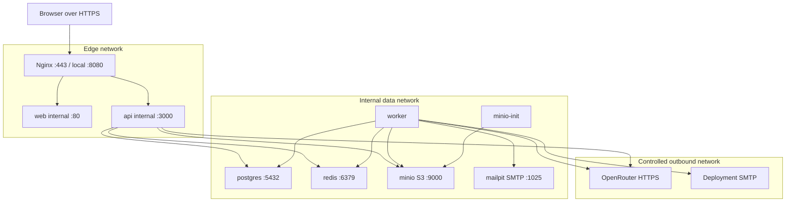

# Infrastructure and deployment design

Phase 0 documentation only. No Compose files, Dockerfiles, services or dependencies have been created. Commands below are planned Phase 1/10 workflows, **not commands executed in Phase 0**. Validate pinned versions and exact command behavior during implementation.

## Compose services

| Service | Purpose / health / persistence |
|---|---|
| `nginx` | Sole public edge, routes SPA, `/api/` and `/socket.io/`; configuration/HTTP health check; no business-data volume |
| `web` | Multi-stage Vite build served as static assets by internal HTTP server; HTTP health; immutable assets |
| `api` | NestJS REST and text gateway; `/health/live` and `/health/ready`; stateless filesystem |
| `worker` | Separate process, queue consumers plus DB outbox dispatcher/deadline/retention loops; process health and DB heartbeat with freshness probe |
| `postgres` | Private relational store; `pg_isready` and application readiness verifies schema version; `postgres_data` |
| `redis` | Private BullMQ coordination, authenticated connection, ping health, AOF persistence and `noeviction`; `redis_data` |
| `minio` | Private S3 API and admin console; service readiness probe; `minio_data` |
| `minio-init` | One-shot idempotent private-bucket and least-privilege app-policy bootstrap after MinIO healthy; exits successfully, no anonymous access |
| `mailpit` | Local SMTP and mailbox UI only; local readiness probe, optional `mailpit_data`; real SMTP replaces it for deployment |

Initial stack uses one API and one worker, with independent queues/concurrency inside the worker. Separate parsing/turn worker processes can later use the same image if measured resource contention requires it. No Kubernetes, Kafka, payment services or extra application microservices.

Phase ownership: Phase 1 provides worker/DB/Redis/Mailpit connectivity only. Phase 2 implements the SMTP adapter, notification queue, tenant and global-auth delivery/outbox schemas, DB-polled dispatcher, encryption/key handling, leases/retries/status and purge loops. Phase 2 startup enables those consumers without any Phase 3 AI or Phase 6 candidate modules. Phase 3 adds AI consumers; Phase 6 adds candidate invitation templates. No new Compose service is needed to resolve the email dependency. SMTP/encryption configuration is therefore required for Phase 2, not first introduced in Phase 6; Mailpit delivery/failure/restart checks are Phase 2 acceptance gates.

## Networks and edge



Attach data services only to an internal network; API/worker additionally need an egress-capable network for provider calls/SMTP. Docker networks alone do not enforce provider allowlists; deployment firewall/proxy policy must enforce required outbound restrictions. Nginx joins edge only; it reaches API/web there, not database. Base configuration publishes only Nginx. Dev override may expose admin tools on `127.0.0.1` (Mailpit UI, MinIO console and optional DB ports); never bind these to public interfaces by default. Do not expose MinIO root credentials to API/worker; use bootstrap-created private application credentials.

Nginx serves SPA fallback through web, proxies `/api/` unchanged and Socket.IO polling/upgrade paths with correct upgrade headers and timeouts. Static asset caching uses fingerprinted filenames; index document is revalidated. Unknown API paths return API errors, never SPA HTML. Align edge body limits with API per-file and total multipart limits (proposed 10 MiB/file, 50 files/bulk; use sequential/bounded client uploads rather than one huge request). Proxy deadlines must exceed synchronous auth/REST limits; long operations return IDs, not long-held HTTP requests. Apply CSP, no-referrer, safe content type and frame restrictions; configure trusted proxy hops explicitly for rate-limit client IPs.

## Environment and secrets

Future `.env.example` contains names and non-secret examples only. Validate environment on startup; redact config logs. Proposed groups:

| Group | Variables / handling |
|---|---|
| Runtime | `NODE_ENV`, `PUBLIC_APP_URL`, `API_PORT`, explicit allowed origin, trusted proxy configuration |
| Database/queue | `DATABASE_URL`, `REDIS_URL`; separate migration credentials from least-privilege runtime role |
| Auth | JWT signing/verification key material and key ID, token pepper if used, cookie/CSRF settings; rotation procedure |
| AI | `AI_PROVIDER`, `OPENROUTER_API_KEY`, `OPENROUTER_BASE_URL`, nine `AI_MODEL_*` keys from [AI workloads](ai-workloads.md), provider/privacy policy, token/cost/concurrency limits |
| Storage | `S3_ENDPOINT`, region, bucket, TLS/path-style settings, app access/secret keys; separate MinIO bootstrap root secrets |
| Email | `SMTP_HOST/PORT/USER/PASSWORD`, TLS mode, sender, `NOTIFICATION_ENCRYPTION_KEY` and key version for short-lived token email payloads |
| Policy | Upload/parser limits, invitation TTL, interview ceilings, retention and notice version, scanner enforcement mode |

Secrets are injected at runtime through protected environment or deployment secret files; never baked into image layers, frontend bundles or Git. `VITE_*` values are public and may contain only non-sensitive web configuration. Development HTTP exceptions and explicit deterministic mock settings must fail validation in production where inappropriate. Mock production demonstrations require an unmistakable non-production environment, not silent downgrade.

## Build, startup and migrations

Use pinned compatible Node LTS, pnpm and service image versions chosen/verified in Phase 1; no floating `latest`. Multi-stage builds install from lockfile, build shared dependencies before apps, and copy only runtime artifacts. Run application processes as non-root; minimal writable temporary directories for bounded parsing, read-only filesystems where practical, resource limits and graceful SIGTERM handling. The worker stops claiming new work, drains within a bounded grace period and leaves unfinished leases recoverable.

Planned fresh local workflow after Phase 1 has implemented scripts/config:

```sh
cp .env.example .env
# Configure local secrets and explicitly select AI_PROVIDER=mock or openrouter.
pnpm install --frozen-lockfile
docker compose build
docker compose up -d postgres redis minio mailpit
docker compose run --rm minio-init
docker compose run --rm api pnpm --filter @smart-recruit/api prisma:migrate:deploy
docker compose up -d web api worker nginx
docker compose ps
```

These package/script names are proposed contracts for Phase 1. They do not exist yet. Compose migration runs use a schema-owner credential supplied only to that one-shot command; API/worker runtime credentials cannot modify schema. No migrations automatically run on every API replica and no production `db push`. Migration deployment is serialized with advisory locking/tool support and fails startup release on errors. Seed only synthetic demo fixtures via explicit development command. Existing database changes require reviewed migration SQL and backup/rollback plan; prefer expand/contract migrations compatible with previous runtime. Rollback may require roll-forward data repair, not blind down-migrations.

Dev override supplies bind mounts and named dependency volumes, Vite HMR through the edge and Nest/worker watch commands. Planned invocation after migrations: `docker compose -f docker-compose.yml -f docker-compose.dev.yml up --build`. Keep database/object/queue state in named volumes across rebuilds. Document destructive volume reset separately; never make it the normal startup procedure.

## Readiness and failure behavior

Liveness checks only process/event-loop responsiveness, avoiding dependency restart storms. Readiness verifies schema compatibility and required connections/configuration. API can return route-specific degraded responses when Redis/SMTP is down: DB-backed commands that safely queue via outbox may succeed, while a dependency-requiring operation returns a retryable failure. Health output includes component status without secrets. Dependency failures must not make the reverse proxy drop all otherwise safe requests; define a critical-ready signal separately from detailed degraded status. Real AI configuration/catalog verification is a Phase 3 startup/preflight gate, but health probes never issue paid inference calls.

Compose health dependencies improve initial ordering; runtime code must still reconnect/back off because services can fail later. Worker readiness requires PostgreSQL, Redis and schema compatibility; outbox reconciliation resumes after recovery. MinIO-init failure blocks upload capability. Mailpit is for local use only; deployed SMTP failure is a visible notification failure and does not roll back issued invitation records. External dependency-specific recovery is specified in [architecture](architecture.md) and [AI workloads](ai-workloads.md).

## Production release requirements

- TLS at deployment edge with certificate renewal, secure cookies, explicit origins, request/rate limits, no public DB/Redis/storage-admin ports; disable/protect developer documentation endpoints as appropriate.
- Encrypted PostgreSQL backups with point-in-time recovery where available; private object backups/version policy; secret/key backup and rotation. Redis persistence is helpful but not a substitute for the PostgreSQL operation ledger.
- Proposed operational targets for owner approval: database RPO 15 minutes and service RTO 4 hours; object durability/recovery must align. These are targets requiring restore drills, not achieved guarantees.
- Test restoration of database, objects, key material and deletion ledger together in an isolated environment before reopening access. Object versioning must not defeat privacy deletion; purge all versions according to retention policy.
- Configure real provider/model/privacy routes, real SMTP, malware scanning enforcement, candidate notices, jurisdiction-specific retention and log/audit retention. Resolve before production even if local development can proceed.
- Monitor disk/volume capacity, queue age, lease recovery, DB connections, storage failures, email failures, AI latency/cost/schema failures and backup freshness. Logs and metrics exclude sensitive payloads.

Compose is the prescribed initial deployment unit; production capacity, high availability and horizontal scaling are future decisions driven by measured needs. Phase 10 proves the documented workflow and restores/recovery behavior with actual commands and records results.
