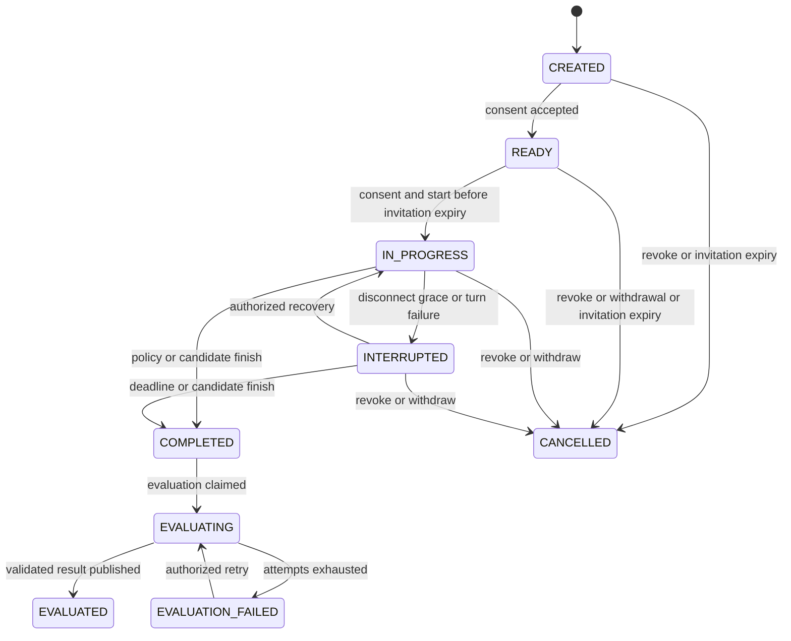

# Text interview lifecycle

Phase 0 design. PostgreSQL is authoritative; `InterviewOrchestrator` accepts typed commands and returns durable state/events without Socket.IO types. `TextInterviewGateway` authenticates and translates transport messages only. REST and worker commands call the same orchestrator. No excluded media functionality is part of this design.

## Ownership, invitation and start

An invitation pins job candidacy, selected resume, approved rubric and approved plan and belongs to one durable `InterviewAttempt`. Proposed default: `expiresAt = issuedAt + 7 days`. **Invitation expiry is the acceptance/start cutoff, even if the link was already exchanged or consent recorded.** The candidate must start strictly before `expiresAt`; at equality it is expired. Once started, only the immutable interview `deadlineAt` bounds collection time: invitation expiry does not cancel an `IN_PROGRESS` or `INTERRUPTED` session. Grants independently control browser access and cannot extend either deadline. This is the selected engineering default for the existing master §10 expiry/attempt policy, not a new product requirement.

Bulk issuance returns per-item outcomes/idempotency results and uses the same candidacy lock as individual issuance. Resend while unstarted rotates the token and revokes old grants but retains the original `expiresAt`, attempt and session. Expired unstarted invitations require explicit recruiter re-invitation, never a resend that silently extends the old attempt. A started session may receive a recruiter-issued recovery-token rotation, whose `tokenExpiresAt` is bounded by the existing `deadlineAt`; it does not change `expiresAt`, session or attempt. The original token expires at `expiresAt`; a recovery token is distinguished by purpose `RECOVERY` and cannot create or start a session. Revocation cancels collection and prevents any token from restoring it.

The browser reads the token from the link fragment, removes it, and posts it over HTTPS to exchange for a scoped HttpOnly candidate cookie. Store only token/grant hashes outside the short-lived encrypted email payload. Token exchange is rate-limited and transactional; first valid START-token exchange before `expiresAt` records `acceptedAt` and creates the sole `CREATED` session, later valid exchanges resume that same session. Acceptance is link exchange, not consent or start. A consumed marker records first acceptance without allowing a second session. A valid RECOVERY token exchanges only for its already-started, nonterminal session before `deadlineAt`. Separate CSRF/origin checks protect candidate REST and Socket.IO handshake; tokens never appear in event logs. Every socket command verifies grant, company/session ownership, current revocation and allowable state.

Candidate sees privacy notice version, purpose, instructions and limits before consent. Consent creates an immutable `ConsentRecord` and moves to `READY`. Explicit start establishes `startedAt`, immutable `deadlineAt`, and first core question in one transaction. No interview question or provider call involving interview answers occurs before consent. Consent withdrawal cancels ongoing collection and creates an auditable privacy request.

### Expiry, access and cancellation policy

All checks use current database time after locks are acquired. The start command and expiry sweep lock in the same order and enforce the same predicate; a delayed sweep never grants extra time. Start atomically verifies active attempt, nonrevoked invitation, valid grant, consent, `READY` and `now < expiresAt`, then writes `startedAt`, `deadlineAt`, first question and events. A pre-start grant expires no later than `expiresAt`. Start rotates it to a grant bounded by `deadlineAt`; shorter grant lifetimes are permitted but require valid reauthentication. No grant outlives its allowed collection window.

| Condition | No session / reserved invitation | `CREATED` | `READY` | `IN_PROGRESS` / `INTERRUPTED` | Completed/evaluation states or `CANCELLED` |
|---|---|---|---|---|---|
| Invitation `expiresAt` reached | Close attempt `EXPIRED`; deny exchange | Cancel session, close attempt `EXPIRED`, revoke grants | Same; consent does not permit late start | No collection-state change; original START token cannot exchange after its expiry, existing valid grant continues | No state change or new collection access |
| Grant expiry | No access | Deny commands; session remains until invitation expiry, valid token may reauthenticate | Same; cannot start with expired grant | Deny browser commands; pending authorized work may finish, clock continues; valid START token or recruiter RECOVERY token may reauthenticate before deadline | Deny access; no reopening |
| Token/grant rotation for resend/recovery | Same reservation, old token invalid | Same session, old grants invalid | Same session, old grants invalid | Same session, deadline and pending turn; replacement grant changes access only | Recovery rotation denied |
| Invitation revocation or candidate withdrawal | Close reservation `CANCELLED` (withdrawal only after acceptance) | `CANCELLED`, revoke tokens/grants | `CANCELLED`, revoke tokens/grants | `CANCELLED`, invalidate pending turn, revoke tokens/grants | Revoke access; preserve frozen assessment/transcript pending separate deletion policy |
| Interview deadline reached | Not applicable | Not applicable | Not applicable | `COMPLETED` with `TIME_LIMIT`, freeze transcript and close attempt `COMPLETED` | Idempotent no-op |

The sweep also cancels expired unstarted sessions; exchange, consent, start and recovery commands perform lazy expiry handling under the same locks. Grant expiry is not invitation revocation and does not cancel server-side work authorized by the accepted answer and continuing consent. Withdrawal records a privacy request and cancels collection; it cannot be undone by reusing an invitation token.

### Attempt ownership across invitations

`JobCandidate` (unique company/job/candidate) owns attempt numbering and the single active reservation. `InterviewAttempt` is allocated **on issuance**, before any token exchange, with status `RESERVED`; it becomes `ACTIVE` only at start. It owns exactly one invitation and at most one session. Resends/recovery rotate credentials on that invitation. An unstarted `CREATED` or `READY` session still holds the `RESERVED` attempt. This prevents two pending invitation tokens from reserving separate live attempts.

| Operation | Transaction and result |
|---|---|
| Issue first invite | Lock `JobCandidate`; expire any due unstarted reservation; reject if a `RESERVED/ACTIVE` attempt remains; allocate next ordinal, insert attempt/invitation/notification/outbox together. |
| Issue another invite with different request key while reserved/active | Reject `ACTIVE_ATTEMPT_EXISTS`; never implicitly replace or create a second invitation. Same idempotency key returns original issuance result. |
| Concurrent token acceptance/start | Lock `JobCandidate`, then attempt, invitation, session (if present). Recheck current token generation/purpose, reservation, expiry and consent. Both acceptance calls can return the same session; they cannot create distinct sessions. Concurrent starts return original idempotent result or conflict. |
| Re-invite after expiry/cancel/completion | Explicit recruiter command with audit reason/key allocates a new ordinal and new invitation only after previous attempt is closed. No lifetime numeric cap is invented: each new attempt needs human authorization and cannot be obtained by candidate/token replay. |
| Re-invite while a prior attempt remains active | Reject; recruiter must explicitly revoke/cancel the old attempt first. A new request can then create another attempt; no automatic takeover. |
| Expire before start | Atomically close attempt `EXPIRED`, cancel any CREATED/READY session, revoke token/grants and cancel unsent notification. |
| Complete or cancel after start | Atomically close attempt `COMPLETED` or `CANCELLED` with session transition and work invalidation. Evaluation states hold no active reservation; the prior transcript remains immutable if a recruiter later authorizes another attempt. |

Database partial uniqueness and ordinal constraints are specified in [database.md](database.md#attempt-and-turn-integrity). Lock order for operations touching multiple aggregates is `JobCandidate → InterviewAttempt → InterviewInvitation → InterviewSession → ProcessingOperation`; no path may acquire these in reverse. Session-only answer/presence operations may lock only session/operation if they never subsequently acquire parent locks. Completion/revocation/deadline and AI intents that can complete must use the parent-first order. A sweeper or issuer closes a due reservation under these same locks, so multiple distinct request keys cannot bypass the limit. Different job candidacies remain independent.

## State machine



| State | Invariants and permitted actions |
|---|---|
| `CREATED` | Ownership established, no accepted consent; read notice, accept consent or cancel. Invitation expiry cancels this state even after link acceptance. |
| `READY` | Consent exists, no clock started; start only with valid grant before invitation expiry, otherwise cancel on expiry. |
| `IN_PROGRESS` | Started clock, at most one unanswered assistant question or pending turn; candidate answers, reads recovery snapshot, explicitly finishes. |
| `INTERRUPTED` | Durable disconnect/turn-error marker; no reset to counters or deadline. Recover, finish, cancel, or time out. |
| `COMPLETED` | Transcript frozen with last sequence/hash and reason; outbox atomically scheduled, no further chat writes. |
| `EVALUATING` | Evaluation operation leased; transcript immutable. Expired lease is requeued, not treated as success. |
| `EVALUATED` | At least one immutable validated evaluation/report exists. Explicit later reevaluation runs as a separate operation while previous report remains visible. |
| `EVALUATION_FAILED` | No successful initial evaluation; transcript preserved, authorized retry available. |
| `CANCELLED` | Terminal collection state; no automatic evaluation. Privacy deletion may separately purge content. |

Evaluation retry from `EVALUATION_FAILED` reuses the frozen inputs; changing model/prompt is an explicit new operation/version. Subsequent reevaluations do not downgrade `EVALUATED` if they fail. Privacy deletion can apply to any state through the deletion workflow without pretending it is an ordinary interview transition. Cancellation after completion is not a transcript edit; revoke access and request deletion separately.

## Deterministic orchestration

Approved defaults proposed for review: 6 core questions, maximum 2 follow-ups per core, 30-minute wall-clock duration. Approval verifies criterion coverage, total count and configured hard ceilings (proposed 12 core, 3 follow-ups, 60 minutes maximum). Use server/database time, not browser time. Clock continues while disconnected to bound exposure; UI communicates it clearly. Deadline closes even unanswered or interrupted sessions with reason `TIME_LIMIT`; unasked criteria are reported, not penalized. Planned early finish uses reason `CANDIDATE_FINISHED`; normal completion uses `PLAN_COMPLETE`.

The backend selects the next core question and emits its exact approved wording. For an answer, the LLM may suggest a follow-up, moving on or completion, but the orchestrator validates intent against pending question, criterion scope, follow-up counter, core coverage, remaining time and session generation. `COMPLETE` is accepted only when policy permits; it cannot skip required core questions. Invalid suggestions trigger bounded retry/failure, not arbitrary advancement. Candidate early finish is independent of AI. If no follow-ups remain, advance deterministically to the next core question; an AI call is unnecessary for that decision.

Persist question IDs, core/follow-up relationship, competency references, counters and prompt/context version with every assistant question. Context summaries cache only bounded context through a known sequence; they never serve as the transcript or evidence. A failed summarization may use bounded original context if it fits the approved budget; otherwise fail visibly. Never silently omit evidence from final evaluation.

## Commands, ordering and commit protocol

Client answer envelope: `sessionId`, `clientMessageId` (UUID), `expectedRevision`, `answerToQuestionId`, and bounded text (proposed 8,000 characters). The server derives company/actor from verified grant. Socket acknowledgements carry `clientMessageId`, committed `messageId`, sequence and new revision. A pending UI message is not displayed as durably sent until acknowledged or found by recovery. A repeated ID with identical content returns the original result; reused ID with different content returns conflict. A different ID targeting an already-answered question is rejected.

```mermaid
sequenceDiagram
  participant C as Candidate
  participant G as Text gateway or REST
  participant O as Orchestrator
  participant D as PostgreSQL
  participant W as Turn worker
  C->>G: answer(idempotency key, revision, question)
  G->>O: authenticated command
  O->>D: lock session; check ownership/state/deadline
  O->>D: message + event + revision + pending operation/outbox
  D-->>O: committed sequence
  O-->>C: durable acknowledgement
  W->>D: claim pending generation / release lock
  W->>W: generate allowed follow-up intent
  W->>D: lock; verify generation/state/deadline; commit next question
  G-->>C: committed event notification
  C->>G: REST snapshot/events after last received sequence
  G->>D: authorized consistent snapshot
  G-->>C: authoritative state and ordered messages
```

Use short row-level session locks (`SELECT ... FOR UPDATE`) within transactions for commands; check expected revision and unique command IDs. Allocate strictly increasing per-session message sequence and a separate event sequence under this lock. The same transaction inserts message/event, updates state/counters and creates pending operation/outbox. Cross-session timestamps never define order. Atomic uniqueness plus session lock prevents double answers from two tabs; stale tabs receive conflict and refresh.

Provider calls happen outside locks. A task captures `conversationRevision`, `turnGeneration`, operation lease generation and input hash; it does **not** fence on the general state `revision` or initiating grant generation. Publication requires the same semantic pins, current pending operation, valid lease, continuing consent, nonrevoked/nondeleted attempt/session and `now < deadlineAt`. It may commit while `INTERRUPTED` due to presence loss without pretending the candidate has reconnected. Terminal transitions invalidate the turn. At most one active turn per session; backend applies hard rate/text-size limits independently of socket throttling.

## Durable pending-turn recovery

`revision` increments for state/presence/access-visible changes and is the client's optimistic command version. `conversationRevision` increments only for accepted answers, published assistant questions, and semantic termination/cancellation. Presence-only `IN_PROGRESS ↔ INTERRUPTED`, grant expiry/rotation and replay do not change it or `turnGeneration`. `turnGeneration` fences retry generations for the same accepted answer; `leaseGeneration` separately fences worker ownership after crashes/timeouts. Do not refresh captured semantic revisions merely to force an old response through.

1. **Accept answer:** authenticate current grant; under session lock check duplicate key before expected revision, then check question/state/deadline. An exact duplicate returns the durable original result even after presence revisions change. Insert one candidate message, increment conversation revision, create a stable operation keyed by `(companyId, sessionId, candidateMessageId, next-turn)`, set `pendingTurnOperationId`, and insert event/outbox in the same transaction. No second answer is accepted while pending, including a failed turn awaiting recovery.
2. **Request AI:** claim operation `PENDING/RETRY_WAIT → RUNNING` with lease generation, persist request attempt ID, input hash, message ID, conversation revision, turn generation, pinned model/prompt/schema and request deadline before calling. An ambiguous crash may cause another billable call; expired leases become retryable within bounded budgets, never an endless RUNNING row.
3. **Persist response:** validate schema/domain output, then under session/operation lock and current fencing checks persist the validated `AIArtifact`, its hash and attempt reference and set operation `RESULT_READY` atomically. This is private staged output, not a chat message. Invalid output retries/fails within budget. If the process dies before this commit the call may be repeated; after commit recovery reuses the artifact without another inference.
4. **Publish once:** under the parent-first locks if completion is possible, verify semantic pins, current operation/lease, state, consent, revocation and deadline again. Commit the chosen next question (or permitted completion), monotonic message/event sequences, counters, conversation revision, operation `SUCCEEDED` and clearing of `pendingTurnOperationId` atomically. An assistant message has unique `responseToCandidateMessageId`; the operation also has unique result identity. Deterministic next-core transitions use this same publication path without an AI call. Only committed messages/events are broadcast.
5. **Presence recovery:** authenticated `RecoverSession` takes the parent-first locks (it may complete an expired session), enforces deadline/revocation, then reconciles pending work. For valid `RUNNING` leave it alone; for `PENDING/RETRY_WAIT` ensure an outbox dispatch; for `RESULT_READY` claim/renew a publication lease with a new lease generation and reuse the artifact without reverting to AI inference; for an expired RUNNING lease requeue with incremented lease generation. Restore IN_PROGRESS only when remaining interruption reasons allow. Presence loss/recovery does not regenerate input or invalidate a valid response. It emits state events without a semantic revision change. Browser reconnection alone never resets retry budgets.
6. **Failure recovery:** automatic retry exhaustion persists `FAILED` plus safe reason and `INTERRUPTED` with reason `TURN_FAILED`, retaining the accepted message and pending operation pointer. An explicit authenticated `RetryPendingTurn` command, with its own idempotency key, may start an audited bounded retry cycle: increment turn/lease generations, reset the cycle deadline/attempt budget according to configured limits, reuse the same input pins/message/operation, set PENDING and insert outbox. On successful publication clear TURN_FAILED; remain INTERRUPTED only if another reason such as disconnection remains. It never resubmits the candidate answer or extends the interview deadline. Rate limits and tenant budgets still apply. Configuration errors require operator correction before retry. A staged valid result is published, not regenerated. Candidate finish or deadline can terminate a failed pending turn.
7. **Stale response:** a lost lease or old retry generation is rejected without modifying the newer operation. A terminal/revoked/deleted session cancels the still-current pending operation and clears its pointer atomically; discard staged text under retention policy. If semantic pins mismatch while the operation is still current and the session nonterminal (an invariant violation, not an ordinary reconnect), mark it FAILED with `TURN_CONTEXT_CONFLICT` and expose an explicit recoverable error; never leave it RUNNING or silently adopt new inputs. An audited recovery may reconstruct the operation from the immutable accepted answer and authoritative transcript only if it is still the unanswered turn; otherwise require staff intervention or finish. Ordinary presence changes cannot reach this branch.

Grant rotation invalidates old browser commands, not work already authorized by a committed answer. Workers recheck current session consent/attempt revocation rather than require the initiating grant to stay valid. Invitation revocation/withdrawal/deletion are semantic cancellation, not grant rotation. Recovering with a new valid grant finds the same pending operation. Worker/API restart and Redis reconciliation use this same recovery algorithm; the DB-polled reconciler handles pending, expired leases and RESULT_READY independently of connected browsers.

The operation ledger records `PENDING`, `RUNNING`, `RETRY_WAIT`, `RESULT_READY`, `SUCCEEDED`, `FAILED`, `CANCELLED`; each has a documented next action. No socket delivery controls operation success. Unique accepted-answer and response keys, one pending pointer, semantic fences and sequence allocation prevent duplicate or out-of-order next questions even when provider calls or event broadcasts are duplicated.

## Reconnect and failures

REST `GET /api/v1/candidate/session` returns a consistent authorized snapshot: state/revision and conversationRevision, deadline, current question, pending operation ID/status/turnGeneration and accepted candidate message ID, message/event high-water marks, plan progress and consent version. Paginated `/messages?afterSequence=` and `/events?afterSequence=` replay durable records. Capture a snapshot high-water mark transactionally, then page through that bound; subsequent events are replayed separately. Do not expose internal evaluation reports to candidate grants.

On reconnect authenticate again, fetch snapshot/replay, deduplicate by committed IDs/sequences, then subscribe from high-water mark. If a live event is missed or out of order, fetch REST gaps. A single API instance may poll committed event IDs for notification delivery; notifications are at-least-once hints, never the source of truth. No need to broadcast private transcript text through Redis. API restart automatically rebuilds delivery from durable cursors/recovery requests.

Disconnect sets `INTERRUPTED` after a proposed 30-second grace if no authorized connection/heartbeat remains. The sweep persists heartbeat/disconnect timestamps sufficiently for restart recovery; ephemeral socket presence only informs the sweep. Multiple tabs do not let one disconnect interrupt another active connection. The deadline sweep runs from DB due times and also checks deadline on every command. If workers are down at deadline, the next command/recovery enforces expiry before accepting data; no extra interview time is granted.

Lost acknowledgement: resend same client ID or recover by REST. Redis outage: answers can commit pending operations, UI shows waiting, outbox later redispatches; do not accept a second answer while pending. OpenRouter failure: bounded retries then `INTERRUPTED` with safe error and recovery/retry action, preserving accepted answer. No provider failure creates invented questions or answers. Database outage: no durable acknowledgement; client retains pending input and retries same ID. Browser refresh may lose unsubmitted input; committed messages always recover. Deletion/revocation closes transport and subsequent commands are denied even if a stale socket remains connected.

Completion uses the parent-first lock order, enforces no further answers, increments conversation revision and invalidates pending generation, cancels/clears unfinished turn work (an operation performing valid completion is marked SUCCEEDED instead), closes the attempt reservation, freezes transcript and inserts evaluation operation/outbox in one transaction. Evaluation validates citations and excludes unasked criteria from scoring as defined in [database.md](database.md). A report failure leaves operation retryable; reuse already validated evaluation artifact instead of rerunning it unnecessarily.

## Required verification

Unit tests cover every allowed and denied transition, exact core selection, follow-up caps, early finish, deadlines, unasked criteria and stale generations. Real PostgreSQL integration tests race duplicate IDs, different IDs for one question, two tabs, finish versus provider return, revoke versus send, and evaluation lease recovery. Fault tests cover API restart after commit before ack, Redis loss after publish, provider failure, reconnect replay gaps and worker restart. Candidate ownership tests attempt another session via REST, Socket.IO handshake, room joins and individual events. Browser E2E covers consent, keyboard chat, pending/error state, disconnect/reconnect, completion and recruiter report visibility.

Remediation regression gates (planned, not executed): exchange before expiry then cross it in CREATED/READY/IN_PROGRESS; race start at the expiry boundary; expire a grant independently; rotate a recovery token while AI runs; issue/accept distinct invitations concurrently for one candidacy and another job; re-invite after expiry/completion; disconnect/reconnect during RUNNING and RESULT_READY; crash before/after artifact persistence and publication; exhaust and explicitly retry a turn. Assert one accepted answer, at most one published next question, unchanged deadline, no permanently pending operation and no token-based extra attempt.
